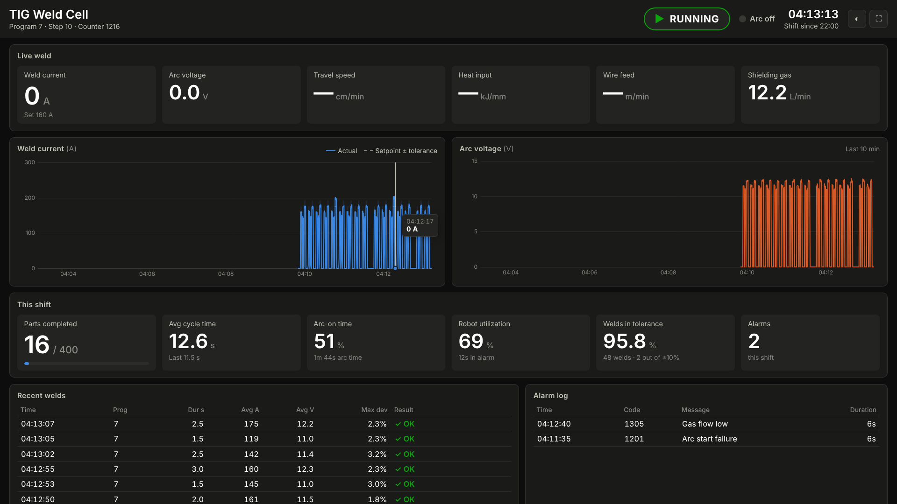

# TIG Weld Cell Dashboard

A live dashboard for an **OTC Daihen TIG welding robot** that runs on a shop-floor screen.
It reads data from the robot cell, works out shift production metrics, and shows them in a
full-screen browser page that updates about twice a second.



## What it shows

| Area | Metrics |
|---|---|
| **Header** | Robot state (Running / Idle / Teach / Stopped / Alarm / E-Stop / No data), arc on/off, program and step, part counter, clock, current shift |
| **Live weld** | Weld current vs setpoint (with ±% deviation), arc voltage, travel speed, heat input (kJ/mm), filler wire feed, shielding gas flow |
| **Trends** | Weld current with setpoint and tolerance band, arc voltage; last 10 minutes, hover for values |
| **This shift** | Parts completed vs target, average and last cycle time, arc-on time %, robot utilization %, time in alarm, welds within current tolerance, alarm count |
| **Recent welds** | One row per bead: start time, program, duration, average A and V, worst current deviation, OK or out of tolerance |
| **Alarm log** | Alarm code, message, when it happened, how long it lasted (active alarms highlighted) |

Each weld bead is also written to `weld_logs/welds-YYYY-MM-DD.csv` to give you a traceable weld record.

## Quick start (no robot needed)

Requires Python 3.11+. The dashboard uses only the standard library, so there's nothing to install.

```bash
python -m weld_dashboard            # built-in simulator, http://localhost:8080
```

Open `http://<this-pc>:8080/` on the display. Press ⛶ for full screen and ◐ to switch light/dark.
Add `?theme=light` to the URL to make a kiosk browser start in light mode.

## Connecting to the robot

OTC Daihen FD-series controllers don't have one standard "data API". How you get the numbers
out depends on the options installed on your cell. Pick the route that matches it, copy
`config.example.toml` to `config.toml`, and fill in the matching `[source]` block.

| Your cell has… | Use | Notes |
|---|---|---|
| A PLC, or a fieldbus option (EtherNet/IP, PROFINET, CC-Link, DeviceNet) wired to a PLC | `modbus_tcp` (most PLCs can act as a Modbus TCP server) or `opcua` | Get the integrator to map arc-on, current, voltage, program/step, run state, alarm code, and the cycle counter into PLC registers/tags. Then list those addresses in the config. |
| A Modbus TCP gateway on the controller or welding power source | `modbus_tcp` | Use the register map from the gateway/manual. Supports 16/32-bit ints, floats, scaling, and bit-in-word. |
| An OPC UA server (PLC, Kepware, IIoT gateway) | `opcua` | `pip install asyncua`, then map node ids to fields. |
| Daihen's weld monitoring software, or any logger that writes CSV | `csv` | Follows the file as rows are appended. Map column headers to fields. |

Every field is optional: map what you have, and tiles without data show "—".
Robot state can come from a numeric code (map it with `[source.state_codes]`) or a text value.
If no arc-on signal is mapped, the dashboard treats the arc as on whenever current is above `arc_on_threshold_a`.

Test the connection with `python -m weld_dashboard -v`. Read errors appear in the log and on the
screen ("Not receiving data from the robot — …"), and the poller reconnects automatically.

## Running it permanently

* **Server**: run `python -m weld_dashboard` as a service (systemd, NSSM on Windows, or a startup task)
  on a PC that can reach the robot network.
* **Display**: point a kiosk browser at it, e.g.
  `chromium --kiosk --noerrdialogs http://weld-dashboard:8080/`.
  Any number of screens, tablets, or phones can connect at the same time.
* Shift counters reset at the times in `shift_starts`. They live in memory, so restarting the server
  mid-shift starts the counts from zero. The weld CSV log is kept.

## API

* `GET /api/snapshot`: current state, shift metrics, weld/alarm logs, and trend history (JSON).
* `GET /api/stream`: the same data as Server-Sent Events, pushed on every poll.

These are handy if you also want to feed MES/SCADA or a spreadsheet.

## Development

```bash
python -m unittest discover -s tests       # unit tests (includes a fake Modbus device)
python -m weld_dashboard --simulate --port 8099
```

Layout: `weld_dashboard/sources/` contains one adapter per data source, `model.py` has the metrics/shift logic,
`server.py` serves HTTP and SSE, and `static/` holds the page (vanilla JS with a small canvas chart, no CDN, so it
works on an isolated plant network).
